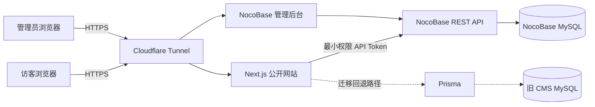
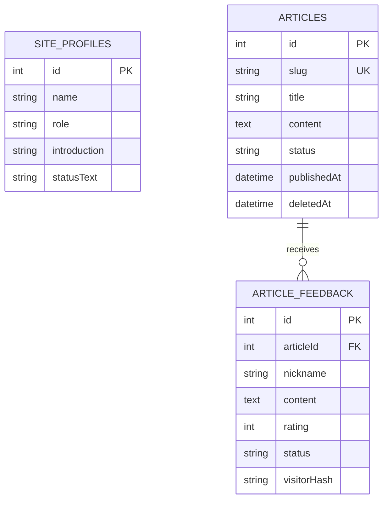
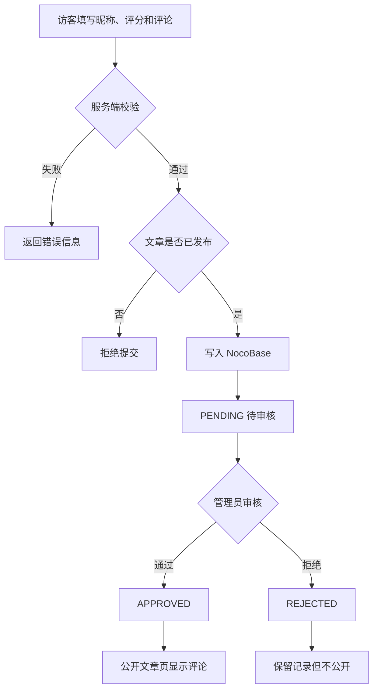
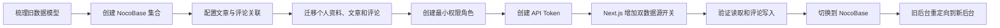
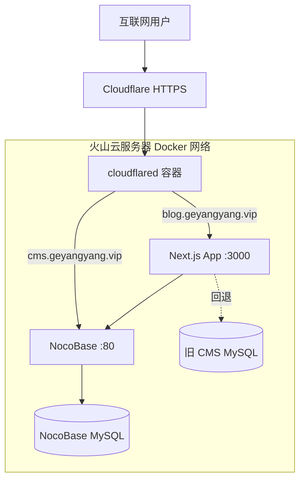
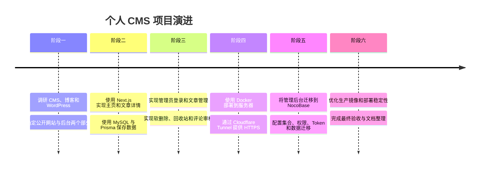

# 从零搭建个人 CMS：一个独立开发者的项目实践

> 作者：盖洋阳
>
> 项目定位：个人主页、博客与内容管理系统
>
> 技术关键词：Next.js、TypeScript、NocoBase、MySQL、Docker、Cloudflare Tunnel

## 一、项目背景

刚接到这个任务时，我对 CMS、个人博客和 WordPress 都没有系统了解，最担心的问题不是代码怎么写，而是不知道应该从哪里开始。

经过调研，我逐渐理解到：博客主要用于向访客展示文章，而 CMS（内容管理系统）的核心价值，是让发布者不需要修改代码，也能在后台管理个人资料、文章和评论。WordPress 是一个成熟的通用 CMS，而我的任务不是直接安装 WordPress，而是先从零实现一个适合个人网站的小型 CMS，再通过这个过程理解一套内容管理系统是怎样构成的。

因此，我把项目目标确定为两个部分：

1. 面向访客的公开网站，用于展示个人介绍和已发布文章；
2. 面向管理员的管理后台，用于管理个人资料、文章和评论审核。

项目开发过程中，我使用 AI 辅助分析需求、编写代码和排查问题，但每完成一个模块，我都会继续追问“为什么这样做”，并通过实际操作验证结果。

## 二、项目核心功能

公开网站实现了以下功能：

- 展示个人介绍；
- 展示已发布文章列表；
- 使用稳定的 `slug` 生成文章网址；
- 隐藏草稿、已下线和软删除文章；
- 允许访客提交昵称、评论和 `0～5` 星评分；
- 只展示审核通过的评论。

管理后台实现了以下功能：

- 管理个人资料；
- 创建、编辑、发布和下线文章；
- 管理文章状态；
- 查看待审核评论；
- 通过或拒绝评论；
- 使用角色和字段权限限制网站接口。

## 三、最终系统架构

项目最初使用 Next.js 自己实现公开页面和管理后台，并通过 Prisma 操作 MySQL。随着需求变化，我将后台迁移到 NocoBase，让 Next.js 专注于公开网站，让 NocoBase 负责内容管理。

这个架构中，公开网站和管理后台职责分开：

- Next.js 负责访客页面、服务端数据读取、输入校验和评论提交；
- NocoBase 提供可视化管理后台、数据集合、权限配置和 REST API；
- MySQL 保存个人资料、文章和评论；
- Docker Compose 管理应用和数据库容器；
- Cloudflare Tunnel 提供 HTTPS 访问入口，服务器不需要公开应用端口和数据库端口。

## 四、为什么选择这些技术

| 技术 | 在项目中的作用 | 选择原因 |
| --- | --- | --- |
| Next.js | 构建公开主页、文章详情和服务端逻辑 | 一个项目可以同时完成页面和服务端处理，适合个人项目 |
| TypeScript | 编写应用代码 | 类型检查可以减少字段名、参数和返回值错误 |
| NocoBase | 提供内容管理后台和 REST API | 可以快速配置集合、表格、表单和权限，不必继续手写全部后台页面 |
| MySQL | 保存文章、评论和个人资料 | 数据之间关系明确，适合关系型数据库 |
| Prisma | 旧 CMS 的数据访问和迁移回退 | 能生成类型安全客户端，并通过迁移记录数据库结构变化 |
| Docker Compose | 管理本地与服务器容器 | 统一数据库、应用和 NocoBase 的运行环境 |
| Cloudflare Tunnel | 提供公网 HTTPS 入口 | 不公开 Next.js 和 MySQL 端口，降低直接暴露服务的风险 |
| Git + GitHub | 保存代码历史 | 便于回滚、部署和记录开发过程 |

我没有在第一版中拆分微服务，因为当前只有一个开发者，项目规模也较小。过早拆分会增加接口、跨域、认证和部署复杂度，却不会直接增加用户价值。

## 五、文章与评论的数据关系

项目中的核心数据可以简化为个人资料、文章和评论三类。文章与评论是一对多关系：一篇文章可以收到多条评论，而每条评论只属于一篇文章。

公开网址使用 `slug`，而后台数据关联使用数据库 `id`。这样设计的原因是：标题可能修改，中文标题还会被浏览器编码；数据库 `id` 具有唯一性并且保持稳定，更适合后台定位和数据关联。

## 六、评论审核流程

评论不能提交后立即公开，否则可能出现广告、攻击性内容或恶意链接。因此新评论默认进入 `PENDING`（待审核）状态。

公开页面查询评论时，只查询 `APPROVED` 状态。过滤必须在服务端完成，而不能只通过 CSS 或前端代码隐藏，因为发送到浏览器的数据仍可能被访客查看。

拒绝的评论不会直接删除。保留审核记录可以避免误操作，也方便以后重新判断。

## 七、权限与安全设计

这个项目让我最深刻的认识是：网站不仅要实现功能，还要明确每个角色能看到什么、能修改什么。

### 1. 最小权限 API Token

Next.js 不使用 NocoBase 管理员权限，而是使用单独的“网站接口”角色：

- `siteProfiles`：只读；
- `articles`：只读；
- `articleFeedback`：读取已审核评论、创建待审核评论；
- 评论创建只允许写入文章 ID、昵称、内容、评分和访客哈希；
- 网站接口不能把评论直接写成 `APPROVED`。

即使 Token 泄露，攻击者能操作的数据范围也受到限制，这就是最小权限原则。

### 2. 服务端校验

昵称长度、评论长度、评分范围、文章状态和重复提交限制都在服务端重新检查。前端校验主要改善用户体验，不能作为安全边界，因为攻击者可以绕过浏览器页面直接发送请求。

### 3. 评论防重复与隐私

系统使用匿名 HttpOnly Cookie 生成访客标识，再保存哈希结果，而不是收集邮箱或要求填写真实姓名。昵称不填时显示“匿名访客”。这一设计在满足基础防重复需求的同时，尽量减少个人信息收集。

### 4. 秘密管理

数据库密码、API Token、Tunnel Token 和管理员密码只保存在环境变量文件中，不进入 Git，也不应出现在截图和文档正文中。

## 八、从手写后台迁移到 NocoBase

第一版后台由 Next.js 手写实现，这让我理解了认证、Session、文章状态、软删除和评论审核的底层逻辑。但随着功能增加，继续维护表格、表单、筛选和权限页面会占用大量开发时间。

因此我选择将后台迁移到 NocoBase。迁移不是简单更换页面，而是包含以下步骤：

迁移期间我保留了 `CONTENT_SOURCE=prisma|nocobase` 开关。这样可以先验证新链路，在出现问题时快速切回旧数据源，而不是一次性删除原系统。

## 九、部署结构

生产环境使用 Docker Compose 管理多个服务。数据库和应用端口不直接暴露到公网，外部请求通过 Cloudflare Tunnel 进入。

部署过程中，我实际遇到过 Tunnel 源站地址错误、重复 cloudflared 副本、Token 轮换、服务器磁盘不足和低内存构建超时等问题。这些问题让我认识到：开发完成并不等于项目完成，部署、日志、备份、磁盘空间和回滚方案也是项目的一部分。

## 十、项目实施过程

## 十一、遇到的主要问题与解决方法

| 问题 | 原因 | 解决方法 |
| --- | --- | --- |
| 删除容器后数据仍然存在 | Docker 数据保存在数据卷中 | 区分容器和数据卷，并在删除前先备份 |
| 草稿可能通过网址被访问 | 只在首页隐藏不等于服务端禁止访问 | 文章详情查询同时校验 `slug`、发布状态和软删除状态 |
| 前台评论在旧后台看不到 | 前台已写入 NocoBase，旧后台仍读取 Prisma | 使用 NocoBase 作为唯一后台，旧 `/admin` 重定向到新后台 |
| Cloudflare 返回 502 | Tunnel 源站错误或存在两个连接器副本 | 使用 Docker 服务名作为源站，并只保留一个 cloudflared 副本 |
| Tunnel 出现 1033 | 轮换 Token 后没有在线连接器 | 更新服务器 Token并重建 cloudflared 容器 |
| 服务器构建非常慢或停止 | 磁盘空间耗尽、内存较小且没有 Swap | 清理未使用镜像和构建缓存、增加 Swap、使用 standalone 镜像 |
| API Key 权限过大 | 初始角色选择范围不正确 | 创建独立网站角色，只开放必需集合、动作和字段 |

## 十二、我学到了什么

这个项目让我从“什么都不知道、不会下手”，逐步理解了一个真实网站从页面到数据库、从本地开发到服务器部署的完整过程。

我认为最重要的收获有以下几点：

1. **先完成最小闭环，再逐步扩展。** 先让文章能够发布和访问，再增加后台、评论和审核。
2. **前端隐藏不等于安全。** 权限、状态过滤和输入校验必须在服务端完成。
3. **数据结构需要迁移。** 修改模型只是修改代码定义，数据库结构不会自动变化。
4. **删除容器不等于删除数据。** 容器负责运行，数据卷负责持久化。
5. **部署是工程的一部分。** 网络、域名、Token、日志、磁盘和备份都会影响最终结果。
6. **AI 可以提高效率，但不能代替理解。** 我需要知道每项技术在系统中的作用，也要能解释为什么选择它。

## 十三、当前边界与后续计划

当前项目已完成核心功能、NocoBase 后台迁移和服务器部署验收。博客主页、文章详情、后台跳转、评论提交与审核已在生产环境实测通过。项目还存在以下改进空间：

- 为评论接口增加反向代理级限流和验证码；
- 配置数据库自动备份、异地保存和恢复演练；
- 增加磁盘、容器和异常日志告警；
- 为文章正文增加 Markdown 或经过安全清洗的富文本支持；
- 优化 NocoBase 后台的文章详情和编辑体验；
- 定期轮换 API Token、Tunnel Token 和服务器凭据；
- 继续确认域名、服务器和备案相关要求。

## 十四、总结

这个项目并不是一个能够替代 WordPress 的成熟 CMS，但它已经完成了个人网站最核心的内容闭环：管理员可以在后台管理资料和文章，访客可以阅读文章并提交评论，评论经过审核后再公开展示。

对我来说，它最大的价值不是功能数量，而是让我真正理解了网站框架、数据库、权限、API、容器和部署之间的关系。我从一个不知道从哪里开始的新手，完成了一个能够运行、能够管理内容、能够持续改进的真实项目。
