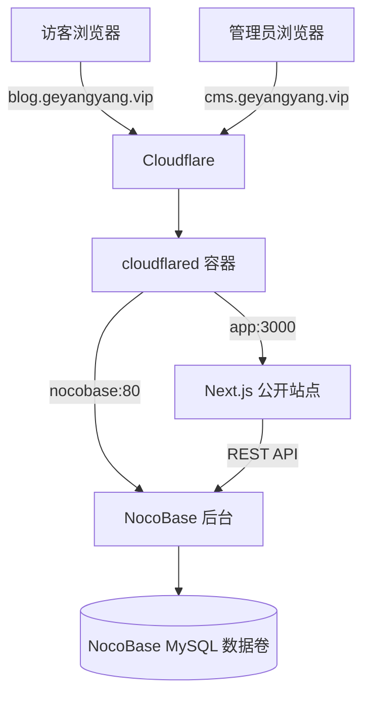

# 火山云服务器与 Cloudflare Named Tunnel 部署手册

> 状态：火山云服务器、Docker Compose、NocoBase、双域名 HTTPS 和 Cloudflare Named Tunnel 已实测通过。

## 1. 部署目标

将盖洋阳个人 CMS 部署到火山云服务器，通过 Cloudflare Named Tunnel 分别提供博客与 NocoBase 后台的 HTTPS 入口。服务器不向公网开放 Next.js、NocoBase 或 MySQL 容器端口。



## 2. 安全规则

- 不提交或截图 `.env.production`。
- 不公开 Tunnel Token、数据库密码、管理员密码和 Cookie。
- 截图中的管理员邮箱、服务器 IP、Cloudflare Account ID 必须打码。
- 不删除服务器现有容器、数据库和 1Panel 配置。
- Cloudflare Tunnel 不应被描述为规避备案的工具；实际接入方式需遵守适用规定。

## 3. 域名接入 Cloudflare

1. Cloudflare Dashboard 选择“添加网站”。
2. 选择“连接域”，不要选择转移或购买域名。
3. 输入主域名，不带 `https://`、`www` 和路径。
4. 选择免费套餐。
5. 检查自动导入的 DNS 记录。
6. 不确定用途的旧记录应保留，并先设为“仅 DNS”。
7. 点击“继续激活”，获取两条 Cloudflare 名称服务器。
8. 在阿里云域名控制台将 DNS 服务器替换为 Cloudflare 提供的两条地址。
9. 等待 Cloudflare 检测完成。

截图位置：

- `images/cloudflare-deployment/01-add-site.png`
- `images/cloudflare-deployment/02-connect-domain.png`
- `images/cloudflare-deployment/03-dns-review-redacted.png`
- `images/cloudflare-deployment/04-cloudflare-nameservers.png`
- `images/cloudflare-deployment/05-domain-active.png`

## 4. 创建 Named Tunnel

1. 进入 Cloudflare Zero Trust。
2. 打开 `Networks → Tunnels`。
3. 创建 Cloudflared Tunnel，名称建议为 `yangyang-personal-cms`。
4. 复制 Tunnel Token，只写入服务器 `.env.production`。
5. 创建博客 Public Hostname：`blog.geyangyang.vip -> http://app:3000`。
6. 创建后台 Public Hostname：`cms.geyangyang.vip -> http://nocobase:80`。
7. 只保留一个正在使用当前 Token 的 `cloudflared` 容器，避免新旧连接器随机转发。

严禁对 Tunnel Token 截图。

截图位置：

- `images/cloudflare-deployment/06-create-tunnel.png`
- `images/cloudflare-deployment/07-public-hostname.png`
- `images/cloudflare-deployment/08-tunnel-healthy.png`

## 5. 服务器项目目录

建议使用：

```bash
/opt/yangyang-personal-cms
```

可通过 GitHub 拉取：

```bash
cd /opt
git clone https://github.com/zly116/yangyang-personal-cms.git
cd yangyang-personal-cms
```

GitHub 网络不可用时，上传不含 `.env`、`node_modules` 和 `.next` 的项目压缩包。

## 6. 生产环境变量

```bash
cp .env.production.example .env.production
chmod 600 .env.production
```

必须替换：

- MySQL root 密码；
- MySQL 应用用户密码；
- `DATABASE_URL` 中 URL 编码后的密码；
- 旧 Prisma 回退数据库所需的连接信息；
- `CONTENT_SOURCE=nocobase`；
- `NOCOBASE_INTERNAL_URL=http://nocobase:80`；
- 最小权限 `NOCOBASE_API_TOKEN`；
- `NOCOBASE_PUBLIC_ADMIN_URL=https://cms.geyangyang.vip/admin`；
- NocoBase MySQL 密码和 `NOCOBASE_APP_KEY`；
- Cloudflare Tunnel Token。

Docker 容器之间必须使用 Compose 服务名，不能使用 `localhost`。密钥文件权限保持为 `600`。

## 7. 启动生产服务

```bash
docker compose \
  --env-file .env.production \
  -f docker-compose.production.yml \
  config --quiet

docker compose \
  --env-file .env.production \
  -f docker-compose.production.yml \
  up -d --build

docker compose \
  --env-file .env.production \
  -f docker-compose.production.yml \
  ps
```

预期 `mysql`、`app`、`nocobase-mysql`、`nocobase` 和 `cloudflared` 均正常运行，数据库与 App 健康检查通过。

截图位置：

- `images/cloudflare-deployment/09-compose-build.png`
- `images/cloudflare-deployment/10-compose-services.png`

## 8. 初始化 NocoBase

1. 首次打开 `https://cms.geyangyang.vip/admin` 并创建管理员。
2. 创建 `siteProfiles`、`articles` 和 `articleFeedback` 数据集。
3. 配置文章与评论关联、文章编辑表单和评论状态编辑操作。
4. 创建“网站接口”角色与最小权限 API Token。
5. 导入资料、文章和评论，再将 `CONTENT_SOURCE` 切换为 `nocobase`。

完整字段与权限说明见 `nocobase-migration-guide.md`。管理员密码不得与本地或截图中暴露过的密码相同。

## 9. 验证网站

依次验证：

1. 公共主页可通过 HTTPS 打开；
2. 已发布文章可访问；
3. 草稿和回收站文章不可公开访问；
4. `blog.geyangyang.vip/admin` 跳转到 `cms.geyangyang.vip/admin`；
5. 管理员可以登录 NocoBase；
6. 个人资料修改后主页更新；
7. 评论提交后进入 `PENDING`；
8. 改为 `APPROVED` 后评论公开；
9. 改为 `REJECTED` 后评论隐藏但记录保留。

截图位置：

- `images/cloudflare-deployment/11-public-home.png`
- `images/cloudflare-deployment/12-admin-login.png`
- `images/cloudflare-deployment/13-admin-overview-redacted.png`

## 10. 日志排查

```bash
docker compose --env-file .env.production -f docker-compose.production.yml logs --tail=200 app
docker compose --env-file .env.production -f docker-compose.production.yml logs --tail=200 mysql
docker compose --env-file .env.production -f docker-compose.production.yml logs --tail=200 nocobase
docker compose --env-file .env.production -f docker-compose.production.yml logs --tail=200 nocobase-mysql
docker compose --env-file .env.production -f docker-compose.production.yml logs --tail=200 cloudflared
```

| 问题             | 检查内容                                           |
| -------------- | ---------------------------------------------- |
| Cloudflare 502 | 博客指向 `http://app:3000`，后台指向 `http://nocobase:80` |
| NocoBase 连接失败 | `NOCOBASE_INTERNAL_URL` 是否使用 `http://nocobase:80`，Token 是否有效 |
| Tunnel 无副本 | `cloudflared` 容器是否运行，Token 是否已轮换，服务器是否可访问 Cloudflare |
| 连续出现随机 502 | 是否同时存在旧独立 cloudflared 和 Compose cloudflared 副本 |
| 后台无法审核 | `articleFeedback` 表格是否有编辑操作，编辑表单是否包含 `status` |

## 11. 更新项目

```bash
cd /opt/yangyang-personal-cms
git pull --ff-only
docker compose --env-file .env.production -f docker-compose.production.yml up -d --build
```

生产镜像使用 Next.js standalone 输出，不携带 Prisma CLI。新增 Prisma 迁移时，应在更新 App 前使用独立构建环境执行 `prisma migrate deploy`；仅包含页面或 NocoBase 接入变更时无需执行数据库迁移。

## 12. 备份与恢复验证

Docker 数据卷不是备份。仓库提供 `ops/backup-nocobase.sh`，默认将压缩备份写入 `/opt/backups/yangyang-cms`，保留 14 天，并且只在完整导出和压缩校验成功后生成最终文件。

```bash
mkdir -p /opt/backups/yangyang-cms
chmod 700 ops/backup-nocobase.sh ops/verify-nocobase-restore.sh
ENV_FILE=.env.production ./ops/backup-nocobase.sh
```

每天凌晨 03:15 自动备份：

```cron
15 3 * * * cd /opt/yangyang-cms && ENV_FILE=.env.production ./ops/backup-nocobase.sh >> /var/log/yangyang-cms-backup.log 2>&1
```

安装计划任务后必须执行一次手工备份，并检查日志、文件大小和 `gzip -t`。备份还应通过对象存储、另一台服务器或受控同步工具复制到服务器之外；异地目标由项目负责人确定。

隔离恢复验证不会覆盖生产数据库。脚本会创建带时间戳的临时数据库，导入备份、确认至少存在一张表，然后自动删除临时数据库：

```bash
ENV_FILE=.env.production ./ops/verify-nocobase-restore.sh \
  /opt/backups/yangyang-cms/nocobase-YYYY-MM-DD-HHMMSS.sql.gz
```

截图只展示备份文件名称、时间、大小和恢复校验结果，不展示 SQL 内容或环境变量。

## 13. 停止服务

保留数据库数据：

```bash
docker compose --env-file .env.production -f docker-compose.production.yml down
```

未完成备份并明确确认前，禁止执行：

```bash
docker compose --env-file .env.production -f docker-compose.production.yml down -v
```

## 14. 当前状态

| 项目              | 证据状态                             |
| --------------- | -------------------------------- |
| Next.js 生产构建    | 已测试通过                            |
| Docker 生产配置     | 已在火山云服务器测试通过                     |
| Cloudflare 域名接入 | 已测试通过                            |
| Named Tunnel | 已测试通过，分别指向 `app:3000` 和 `nocobase:80` |
| 火山云部署 | 已测试通过，App、NocoBase、MySQL 和 cloudflared 正常运行 |
| 后台登录与代理跳转 | 已测试通过，`/admin` 跳转到 NocoBase |
| 评论提交与审核 | 已测试通过，状态闭环为 `PENDING -> APPROVED/REJECTED` |
| 数据库手工备份 | 已测试通过 |

