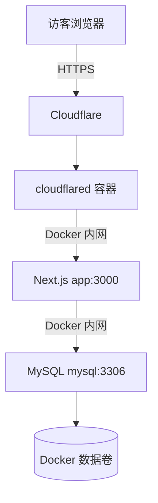

# 火山云服务器与 Cloudflare Named Tunnel 部署手册

> 状态：火山云服务器、Docker Compose、域名 HTTPS 和 Cloudflare Named Tunnel 已实测通过；脱敏截图文件仍待补充到仓库。

## 1. 部署目标

将盖洋阳个人 CMS 部署到火山云服务器，通过 Cloudflare Named Tunnel 提供固定 HTTPS 访问入口。服务器不向公网开放 Next.js `3000` 和 MySQL `3306` 端口。



## 2. 安全规则

- 不提交或截图 `.env.production`。
- 不公开 Tunnel Token、数据库密码、管理员密码和 Cookie。
- 截图中的管理员邮箱、服务器 IP、Cloudflare Account ID 必须打码。
- 不删除服务器现有容器、数据库和 1Panel 配置。
- Cloudflare Tunnel 不应被描述为规避备案的工具；实际接入方式需遵守适用规定。

## 3. 域名接入 Cloudflare

1. Cloudflare Dashboard 选择“添加网站”。
2. 选择“连接域”，不要选择转移或购买域名。
3. 输入主域名，不带 `https://`、`www` 和路径。
4. 选择免费套餐。
5. 检查自动导入的 DNS 记录。
6. 不确定用途的旧记录应保留，并先设为“仅 DNS”。
7. 点击“继续激活”，获取两条 Cloudflare 名称服务器。
8. 在阿里云域名控制台将 DNS 服务器替换为 Cloudflare 提供的两条地址。
9. 等待 Cloudflare 检测完成。

截图位置：

- `images/cloudflare-deployment/01-add-site.png`
- `images/cloudflare-deployment/02-connect-domain.png`
- `images/cloudflare-deployment/03-dns-review-redacted.png`
- `images/cloudflare-deployment/04-cloudflare-nameservers.png`
- `images/cloudflare-deployment/05-domain-active.png`

## 4. 创建 Named Tunnel

1. 进入 Cloudflare Zero Trust。
2. 打开 `Networks → Tunnels`。
3. 创建 Cloudflared Tunnel，名称建议为 `yangyang-personal-cms`。
4. 复制 Tunnel Token，只写入服务器 `.env.production`。
5. 创建 Public Hostname，例如 `blog.example.com`。
6. Service 类型选择 `HTTP`，目标填写 `app:3000`。

严禁对 Tunnel Token 截图。

截图位置：

- `images/cloudflare-deployment/06-create-tunnel.png`
- `images/cloudflare-deployment/07-public-hostname.png`
- `images/cloudflare-deployment/08-tunnel-healthy.png`

## 5. 服务器项目目录

建议使用：

```bash
/opt/yangyang-personal-cms
```

可通过 GitHub 拉取：

```bash
cd /opt
git clone https://github.com/zly116/yangyang-personal-cms.git
cd yangyang-personal-cms
```

GitHub 网络不可用时，上传不含 `.env`、`node_modules` 和 `.next` 的项目压缩包。

## 6. 生产环境变量

```bash
cp .env.production.example .env.production
chmod 600 .env.production
```

必须替换：

- MySQL root 密码；
- MySQL 应用用户密码；
- `DATABASE_URL` 中 URL 编码后的密码；
- 管理员邮箱和全新强密码；
- Cloudflare Tunnel Token。

`DATABASE_URL` 中的主机名必须使用 Docker 服务名 `mysql`，不能使用 `localhost`。

## 7. 启动生产服务

```bash
docker compose \
  --env-file .env.production \
  -f docker-compose.production.yml \
  config --quiet

docker compose \
  --env-file .env.production \
  -f docker-compose.production.yml \
  up -d --build

docker compose \
  --env-file .env.production \
  -f docker-compose.production.yml \
  ps
```

预期 `mysql`、`app` 和 `cloudflared` 均正常运行，MySQL 与 App 健康检查通过。

截图位置：

- `images/cloudflare-deployment/09-compose-build.png`
- `images/cloudflare-deployment/10-compose-services.png`

## 8. 初始化管理员

```bash
docker compose \
  --env-file .env.production \
  -f docker-compose.production.yml \
  exec app npm run db:seed
```

Seed 根据环境变量创建或更新管理员。管理员密码不能与本地或截图中暴露过的密码相同。

## 9. 验证网站

依次验证：

1. 公共主页可通过 HTTPS 打开；
2. 已发布文章可访问；
3. 草稿和回收站文章不可公开访问；
4. 管理员可以登录和退出；
5. 个人资料修改后主页更新；
6. 评论提交后进入待审核；
7. 通过后评论公开；
8. 拒绝后评论隐藏但后台记录保留。

截图位置：

- `images/cloudflare-deployment/11-public-home.png`
- `images/cloudflare-deployment/12-admin-login.png`
- `images/cloudflare-deployment/13-admin-overview-redacted.png`

## 10. 日志排查

```bash
docker compose --env-file .env.production -f docker-compose.production.yml logs --tail=200 app
docker compose --env-file .env.production -f docker-compose.production.yml logs --tail=200 mysql
docker compose --env-file .env.production -f docker-compose.production.yml logs --tail=200 cloudflared
```

| 问题             | 检查内容                                           |
| -------------- | ---------------------------------------------- |
| Cloudflare 502 | App 是否健康，Public Hostname 是否为 `http://app:3000` |
| 数据库连接失败        | `DATABASE_URL` 是否使用 `mysql:3306`，密码是否 URL 编码   |
| Tunnel 未连接     | Token 是否完整、是否已撤销、服务器网络是否可访问 Cloudflare         |
| 后台登录失败         | 是否执行 Seed，管理员账号密码是否与生产环境一致                     |

## 11. 更新项目

```bash
cd /opt/yangyang-personal-cms
git pull --ff-only
docker compose --env-file .env.production -f docker-compose.production.yml up -d --build
```

生产镜像使用 Next.js standalone 输出，不携带 Prisma CLI。新增 Prisma 迁移时，应在更新 App 前使用独立构建环境执行 `prisma migrate deploy`；仅包含页面或 NocoBase 接入变更时无需执行数据库迁移。

## 12. 备份

Docker 数据卷不是备份。上线后需要定期导出 MySQL，并将备份复制到服务器之外。

```bash
mkdir -p /opt/backups/yangyang-cms

docker compose \
  --env-file .env.production \
  -f docker-compose.production.yml \
  exec -T mysql \
  sh -c 'exec mysqldump -u"$MYSQL_USER" -p"$MYSQL_PASSWORD" "$MYSQL_DATABASE"' \
  > /opt/backups/yangyang-cms/yangyang-cms-$(date +%F-%H%M%S).sql
```

截图只展示备份文件名称、时间和大小，不展示 SQL 内容。

## 13. 停止服务

保留数据库数据：

```bash
docker compose --env-file .env.production -f docker-compose.production.yml down
```

未完成备份并明确确认前，禁止执行：

```bash
docker compose --env-file .env.production -f docker-compose.production.yml down -v
```

## 14. 当前状态

| 项目              | 证据状态                             |
| --------------- | -------------------------------- |
| Next.js 生产构建    | 已测试通过                            |
| Docker 生产配置     | 已在火山云服务器测试通过                     |
| Cloudflare 域名接入 | 已测试通过                            |
| Named Tunnel    | 已测试通过，服务目标为 `http://app:3000`    |
| 火山云部署           | 已测试通过，App、MySQL、cloudflared 正常运行 |
| 后台登录与代理跳转       | 已测试通过，不再跳转到 `localhost`          |
| 数据库手工备份         | 已测试通过                            |

