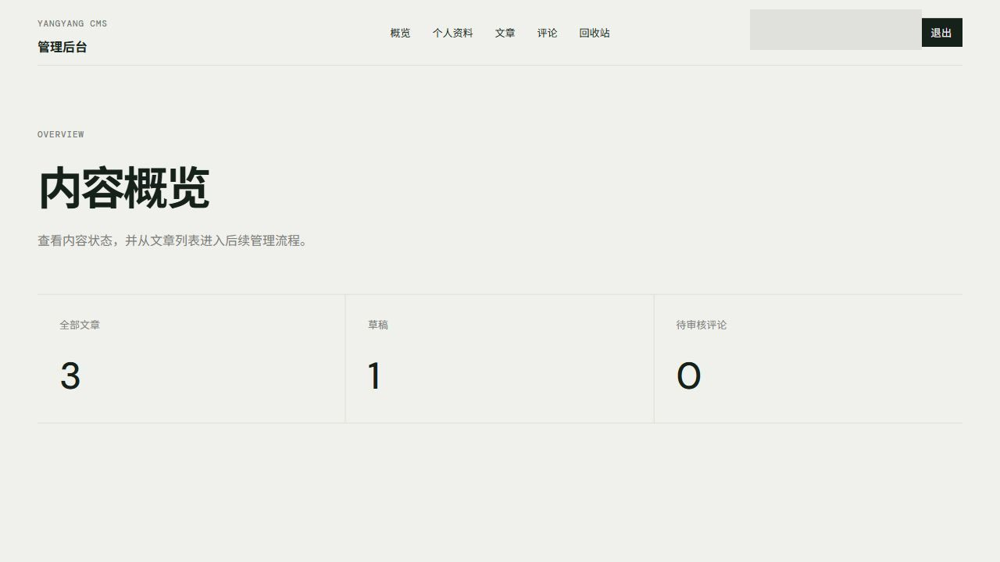
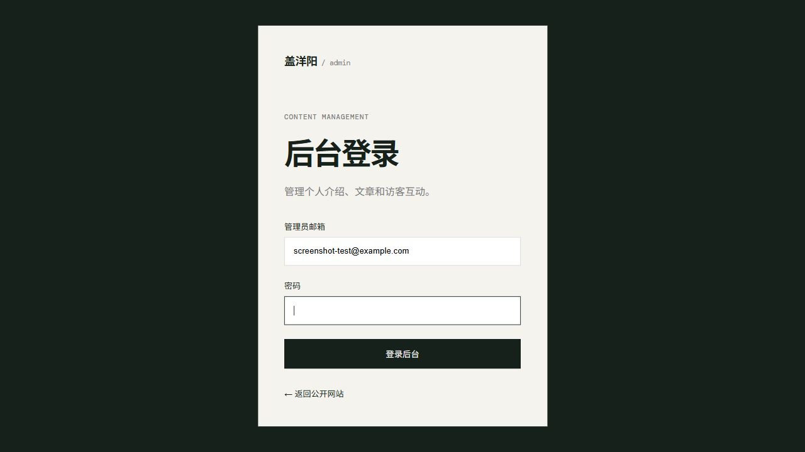
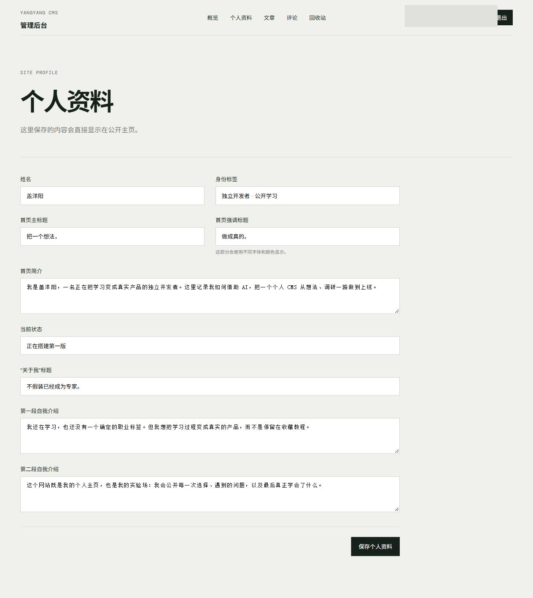
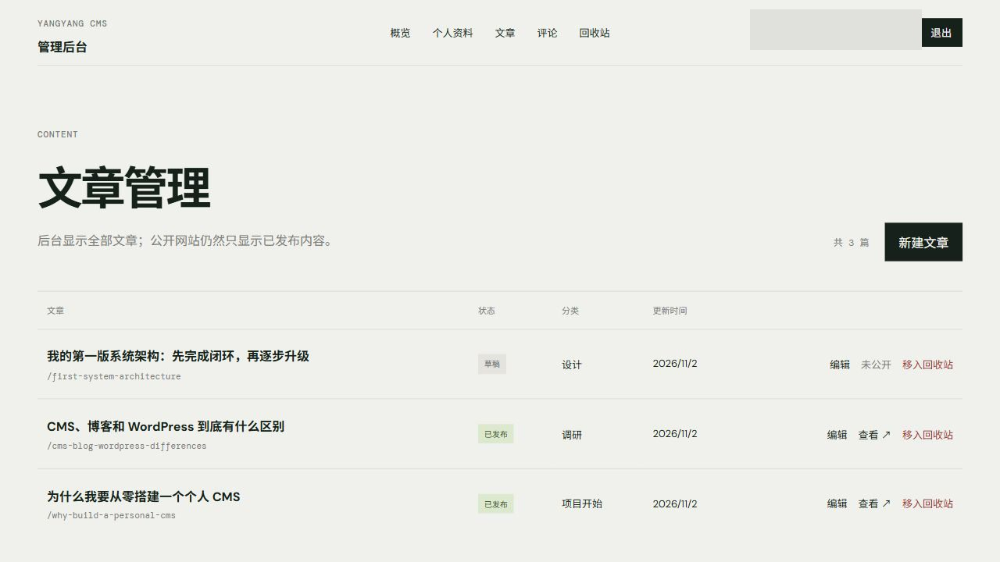
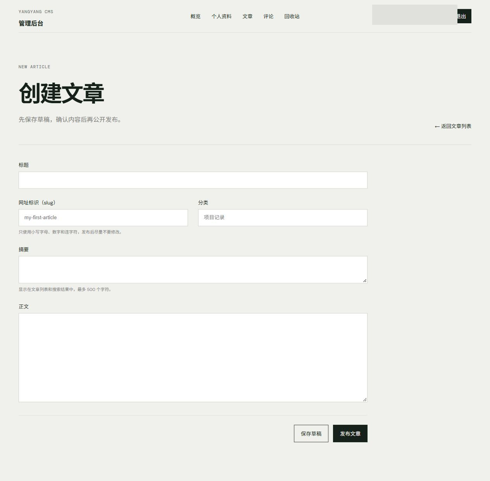
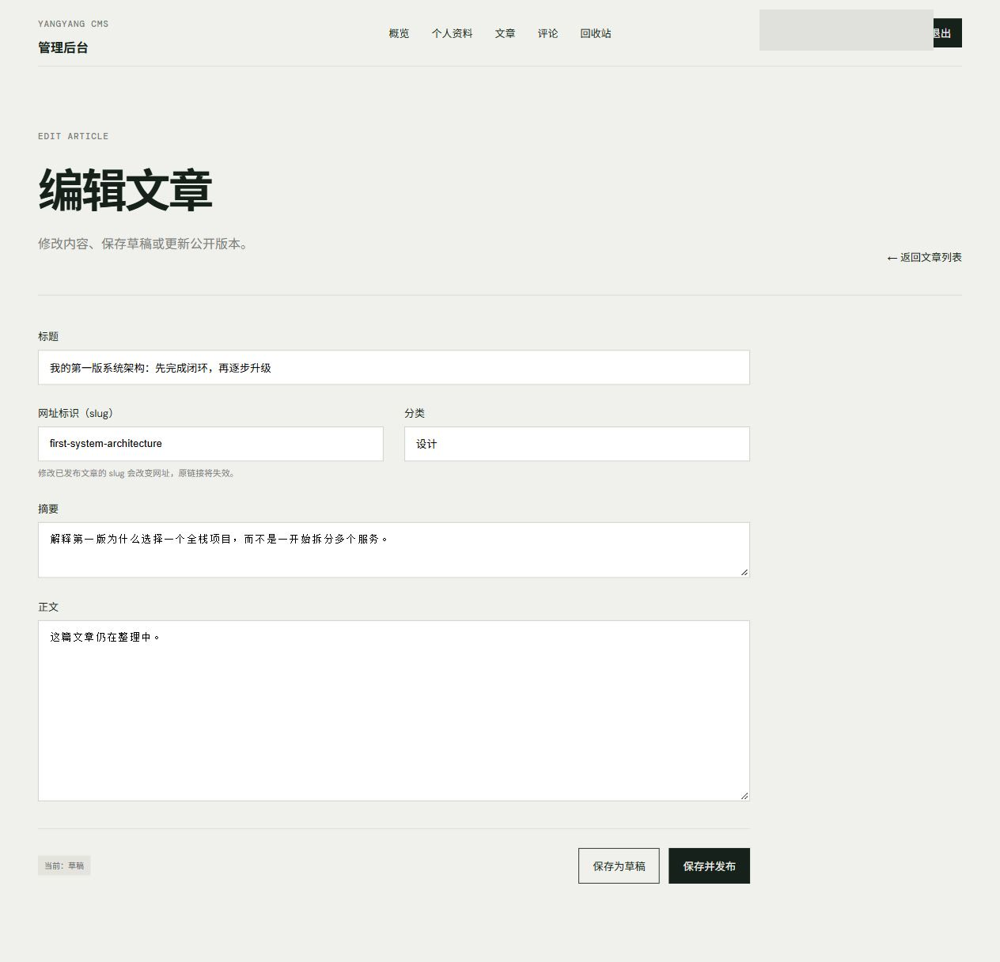
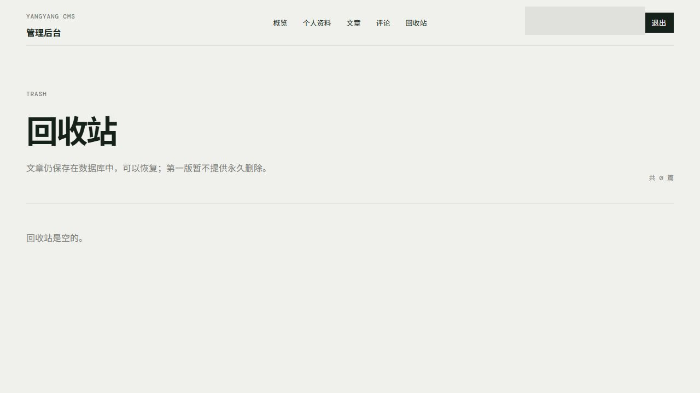
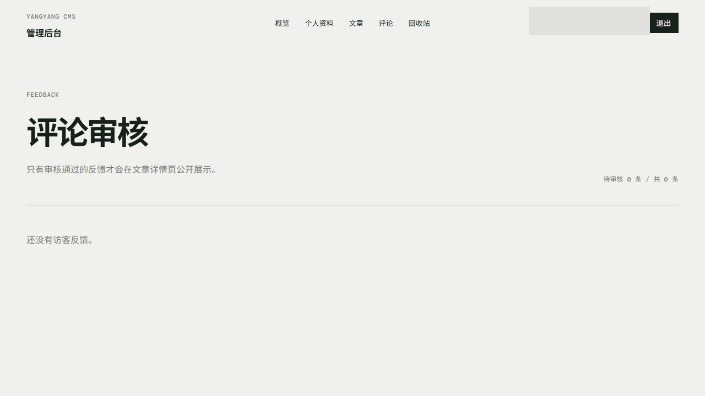

# 盖洋阳个人 CMS 测试手册

> 测试环境：生产环境  
> 公网地址：`https://blog.geyangyang.vip`  
> 文档状态：核心功能已测试通过；已于 2026-11-02 完成公开端和后台主要页面截图归档。

## 1. 测试目的

本手册用于验证个人 CMS 的公开网站、管理后台、权限控制、文章管理、评论评分、软删除恢复和生产部署是否形成完整闭环。测试过程中不得在截图中暴露管理员邮箱、密码、Session Cookie、服务器 IP、数据库密码或 Cloudflare Tunnel Token。

## 2. 测试范围

| 模块 | 测试内容 | 当前证据状态 |
| --- | --- | --- |
| 公开主页 | 个人介绍、已发布文章列表、HTTPS 访问 | 已测试通过 |
| 文章详情 | 使用 slug 访问、正文展示、评分与评论表单 | 已测试通过 |
| 后台认证 | 登录、Session 保持、退出、未登录拦截 | 已测试通过 |
| 个人资料 | 后台修改资料，公开主页读取同一份数据 | 已测试通过 |
| 文章管理 | 新建、编辑、发布、下线、草稿隔离 | 已测试通过 |
| 回收站 | 软删除、隐藏、恢复原状态 | 已测试通过 |
| 评论评分 | 0～5 星、匿名昵称、待审核状态 | 已测试通过 |
| 评论审核 | 通过、拒绝、重新审核、公开端隔离 | 已测试通过 |
| 生产部署 | Docker、MySQL、App、Cloudflare Tunnel | 已测试通过 |
| 截图归档 | 将脱敏后的真实截图保存到仓库 | 已完成（12 张） |

## 3. 测试前准备

1. 使用浏览器访问 `https://blog.geyangyang.vip`。
2. 准备一个访客浏览器窗口和一个管理员浏览器窗口。
3. 管理员账号和密码只在登录页输入，不记录到本手册。
4. 测试文章应使用可识别的临时标题；完成后按需要下线或软删除。
5. 截图前检查页面，不得包含邮箱、密码、Token、Cookie、服务器 IP 等敏感信息。

## 4. 公开网站测试

### TC-PUBLIC-01：访问公开主页

操作：

1. 打开 `https://blog.geyangyang.vip`。
2. 检查浏览器是否使用 HTTPS。
3. 检查个人介绍和文章列表是否正常显示。

预期结果：页面可正常打开，只展示已发布且未被软删除的文章。

结果：**已测试通过**。

截图状态：**已归档**（`images/test-manual/01-public-home.jpg`）

> 当前截图展示主页首屏；文章列表位于页面下方，不在本图范围内。

文章列表区域：`images/test-manual/10-public-article-list.jpg`

### TC-PUBLIC-02：访问文章详情

操作：

1. 从主页打开一篇文章。
2. 检查地址是否使用文章 slug。
3. 检查标题、正文、发布时间、评分和评论区域。

预期结果：文章详情完整显示；地址不依赖中文标题和数据库 id。

结果：**已测试通过**。

截图状态：**已归档**（`images/test-manual/02-article-detail.jpg`）

> 当前截图展示文章标题、摘要、发布时间和正文开头；评分与评论区域位于页面下方，不在本图范围内。

评分与评论表单：`images/test-manual/11-article-feedback-form.jpg`

### TC-PUBLIC-03：验证草稿和回收站隔离

操作：

1. 在后台记录一篇草稿或已删除文章的 slug。
2. 在未登录的访客窗口直接访问对应地址。

预期结果：访客无法看到文章内容。服务端查询必须同时检查 `PUBLISHED` 和 `deletedAt = null`，不能只在前端隐藏入口。

结果：**已测试通过**。

## 5. 后台认证测试

### TC-AUTH-01：管理员登录

操作：

1. 打开 `/admin/login`。
2. 输入管理员邮箱和密码。
3. 提交登录。

预期结果：登录成功后跳转到 `/admin`，Cloudflare 代理环境下不会跳转到 `localhost`。

结果：**已测试通过**。

截图状态：**已归档**。

- 后台概览：`images/test-manual/03-admin-overview-redacted.jpg`
- 后台登录：`images/test-manual/12-admin-login-redacted.jpg`（邮箱为测试占位值，密码为空）

### TC-AUTH-02：Session 与未登录拦截

操作：

1. 登录后刷新后台页面。
2. 关闭并重新打开后台页面。
3. 退出登录后再次访问 `/admin`。

预期结果：有效 Session 期间可以继续访问；退出后数据库 Session 被撤销，再次访问后台时跳转到登录页。

结果：**已测试通过**。

## 6. 个人资料测试

### TC-PROFILE-01：修改个人资料

操作：

1. 进入 `/admin/profile`。
2. 修改一项允许公开的介绍内容并保存。
3. 返回公开主页检查结果。

预期结果：后台更新固定的 `SiteProfile(id = 1)`，公开主页显示最新资料，不新增重复资料。

结果：**已测试通过**。

截图状态：**已归档**（`images/test-manual/04-admin-profile-redacted.jpg`）

## 7. 文章管理测试

### TC-ARTICLE-01：新建草稿

操作：在后台新建文章并保存为草稿。

预期结果：后台文章列表可以看到该文章，公开主页和公开详情页无法看到。

结果：**已测试通过**。

### TC-ARTICLE-02：发布和编辑文章

操作：

1. 将草稿发布。
2. 在公开网站查看文章。
3. 修改正文后再次访问。

预期结果：发布后文章公开可见；编辑正文会更新修改时间，但不会把首次发布时间改成当前时间。

结果：**已测试通过**。

截图状态：**已归档**。

- 文章列表：`images/test-manual/05-admin-articles-redacted.jpg`
- 新建文章：`images/test-manual/06-admin-article-new-redacted.jpg`
- 编辑文章：`images/test-manual/07-admin-article-edit-redacted.jpg`

### TC-ARTICLE-03：slug 唯一性

操作：尝试给两篇文章使用相同 slug。

预期结果：系统拒绝重复 slug，避免两个公开网址指向冲突内容。

结果：**已测试通过**。

## 8. 回收站测试

### TC-TRASH-01：软删除与恢复

操作：

1. 将一篇文章移入回收站。
2. 检查公开网站和后台正常文章列表。
3. 在回收站恢复文章。

预期结果：删除后设置 `deletedAt`，文章从公开端和正常列表隐藏；恢复时清除 `deletedAt`，并保留删除前的草稿或发布状态。

结果：**已测试通过**。

截图状态：**已归档**（`images/test-manual/09-admin-trash-redacted.jpg`）

## 9. 评论与评分测试

### TC-FEEDBACK-01：访客提交评分和评论

操作：

1. 在文章页选择 0～5 星中的任意评分。
2. 昵称留空或填写测试昵称。
3. 填写评论并提交。

预期结果：昵称留空时显示“匿名访客”；系统不收集邮箱；新评论状态为 `PENDING`，提交后不会立即公开。

结果：**已测试通过**。

### TC-FEEDBACK-02：管理员审核评论

操作：

1. 进入 `/admin/feedback`。
2. 查看待审核评论。
3. 分别验证通过、拒绝和重新审核流程。

预期结果：只有 `APPROVED` 评论会被公开查询；`PENDING` 和 `REJECTED` 内容不会发送给访客浏览器；所有审核写入操作都要求管理员权限。

结果：**已测试通过**。

截图状态：**已归档**（`images/test-manual/08-admin-feedback-redacted.jpg`）

## 10. 生产部署检查

| 检查项 | 预期结果 | 实际结果 |
| --- | --- | --- |
| Next.js App | 容器健康 | 已测试通过 |
| MySQL | 容器健康且数据卷持久化 | 已测试通过 |
| cloudflared | Tunnel 正常连接 | 已测试通过 |
| 公网 HTTPS | `blog.geyangyang.vip` 可访问 | 已测试通过 |
| Docker 端口 | MySQL 和 App 不直接暴露公网 | 已测试通过 |
| 数据库备份 | 能生成 SQL 备份文件 | 已测试通过 |
| 自动定时备份 | 有定时任务和异地副本 | 仍未闭环 |
| 恢复演练 | 使用备份恢复到测试库 | 仍未闭环 |
| 监控告警 | 磁盘、容器和异常通知 | 仍未闭环 |

## 11. 截图证据清单

| 序号 | 页面 | 文件 | 脱敏状态 |
| --- | --- | --- | --- |
| 01 | 公开主页 | `images/test-manual/01-public-home.jpg` | 无敏感信息 |
| 02 | 公开文章详情 | `images/test-manual/02-article-detail.jpg` | 无敏感信息 |
| 03 | 后台概览 | `images/test-manual/03-admin-overview-redacted.jpg` | 已遮挡管理员邮箱 |
| 04 | 个人资料 | `images/test-manual/04-admin-profile-redacted.jpg` | 已遮挡管理员邮箱 |
| 05 | 文章列表 | `images/test-manual/05-admin-articles-redacted.jpg` | 已遮挡管理员邮箱 |
| 06 | 新建文章 | `images/test-manual/06-admin-article-new-redacted.jpg` | 已遮挡管理员邮箱 |
| 07 | 编辑文章 | `images/test-manual/07-admin-article-edit-redacted.jpg` | 已遮挡管理员邮箱 |
| 08 | 评论审核 | `images/test-manual/08-admin-feedback-redacted.jpg` | 已遮挡管理员邮箱 |
| 09 | 回收站 | `images/test-manual/09-admin-trash-redacted.jpg` | 已遮挡管理员邮箱 |
| 10 | 公开主页文章列表 | `images/test-manual/10-public-article-list.jpg` | 无敏感信息 |
| 11 | 文章评分与评论表单 | `images/test-manual/11-article-feedback-form.jpg` | 无敏感信息 |
| 12 | 后台登录 | `images/test-manual/12-admin-login-redacted.jpg` | 测试邮箱，密码为空 |

截图使用 JPG 格式；后台页面进行了管理员邮箱遮挡，登录页使用测试占位邮箱且密码为空。本批截图未修改文章、评论或个人资料等业务数据。

## 12. 测试结论

个人 CMS 的核心业务闭环已经完成并在生产环境验证：访客能够查看已发布文章并提交评分评论，管理员能够登录后台、管理个人资料与文章、审核评论、软删除和恢复文章。公开端与后台主要页面截图已归档并完成脱敏。当前不影响核心演示的未闭环项是自动备份、恢复演练、反向代理级限流和生产监控。

