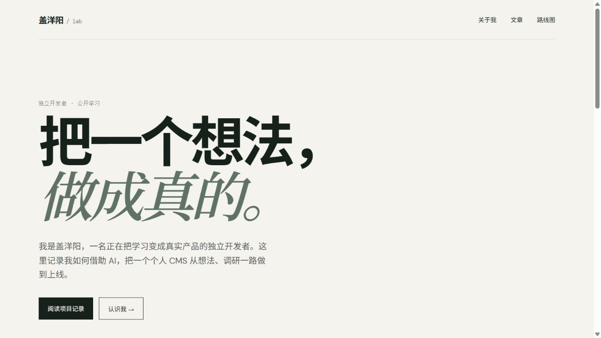
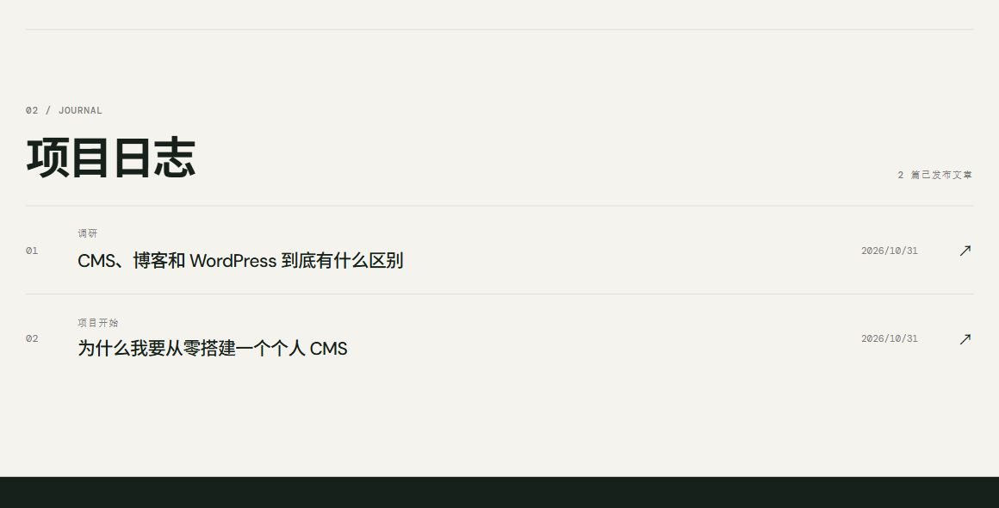
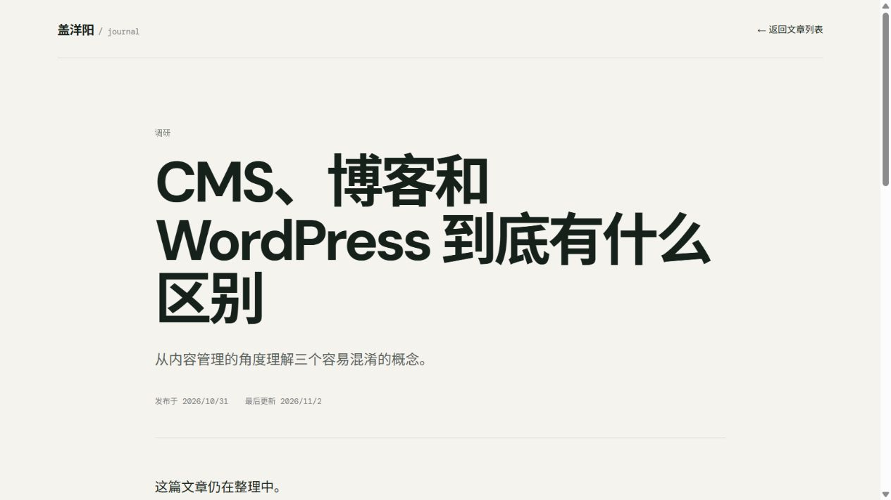
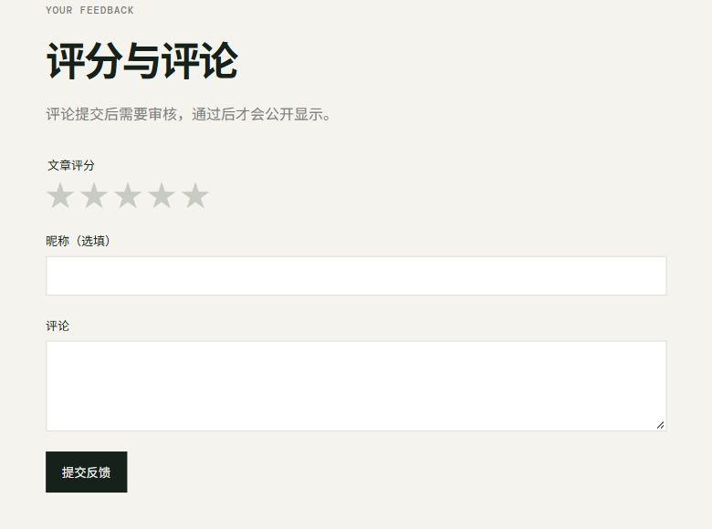
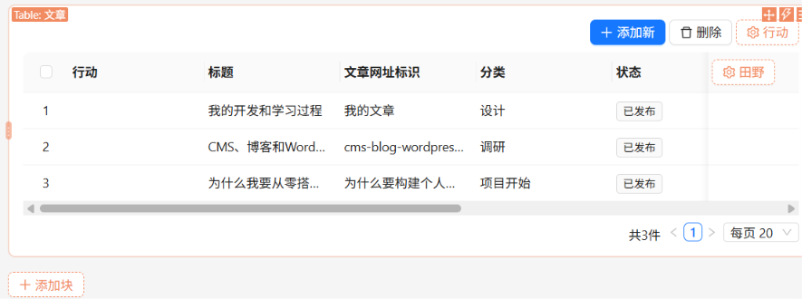
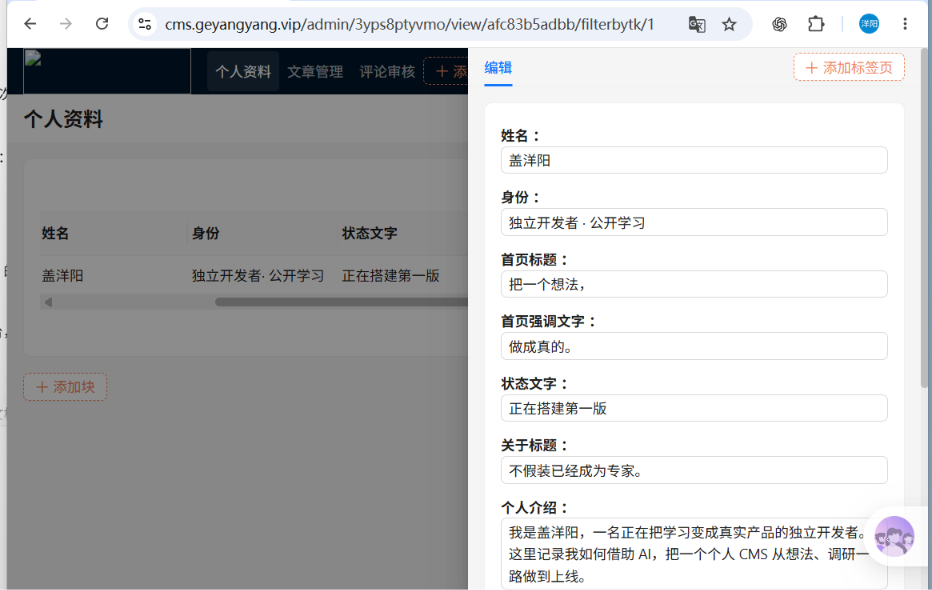
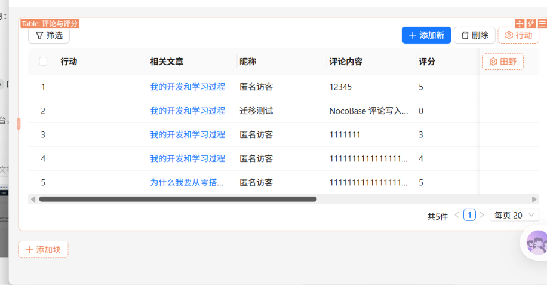
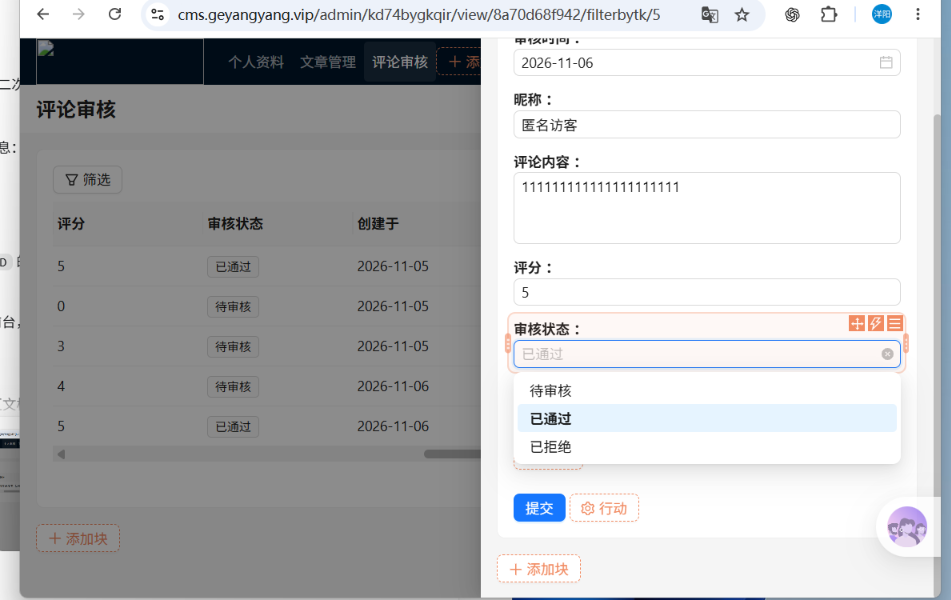

# 盖洋阳个人 CMS 测试手册

> 测试环境：生产环境
>
> 公开站点：`https://blog.geyangyang.vip`
>
> 管理后台：`https://cms.geyangyang.vip/admin`
>
> 最后更新：2026-11-06

## 1. 测试目的

验证 Next.js 公开站点、NocoBase 管理后台、评论审核和 Cloudflare Tunnel 已形成完整闭环。测试与截图中不得暴露管理员密码、API Token、Tunnel Token、Cookie、数据库密码或服务器凭据。

## 2. 当前架构与测试边界

- Next.js 只负责公开主页、文章详情和评论提交。
- NocoBase 是唯一管理后台，负责个人资料、文章和评论审核。
- `blog.geyangyang.vip/admin` 只负责跳转到 NocoBase，不再使用旧手写后台。
- 仓库中的旧后台截图是第一阶段开发记录，不代表当前生产后台。

## 3. 测试概况

| 模块 | 测试结果 |
| --- | --- |
| 公开主页与 HTTPS | 已通过 |
| 文章列表与详情 | 已通过 |
| 草稿、下线和软删除隔离 | 已通过 |
| NocoBase 资料与文章管理 | 已通过 |
| `0～5` 星评分与匿名评论 | 已通过 |
| `PENDING -> APPROVED/REJECTED` 审核 | 已通过 |
| 旧 `/admin` 到 NocoBase 跳转 | 已通过 |
| 公开 AI Portal 页面与对话 | 待部署验证 |
| Docker 与 Cloudflare Tunnel | 已通过 |

## 4. 公开站点

### TC-PUBLIC-01：主页与文章列表

1. 打开 `https://blog.geyangyang.vip`。
2. 检查 HTTPS、个人介绍和文章列表。
3. 确认只展示 `PUBLISHED` 且 `deletedAt` 为空的文章。

预期结果：主页正常打开，不向访客发送草稿或已删除文章。

实际结果：**已通过**。

### TC-FEEDBACK-03：审核时间自动写入

1. 在本地 NocoBase Alpha 中启用“评论审核时间自动更新”工作流。
2. 将一条待审核评论改为“已通过”。
3. 返回评论表格，检查 `reviewedAt`（审核时间）。
4. 打开工作流列表，检查执行次数。

预期结果：只有 `status` 变为 `APPROVED` 或 `REJECTED` 时触发；当前评论的审核时间自动写入，且工作流产生一次成功执行记录。

实际结果：**已通过**。评论 ID 2 的审核时间自动写入为 `2026-11-12 13:54:13`，工作流执行次数由 0 变为 1。该验证仅操作本地 `127.0.0.1:13001`，未修改生产后台。

### TC-PUBLIC-02：文章详情

1. 从主页打开文章。
2. 确认地址使用 `slug`。
3. 检查标题、正文、时间、评分和评论区域。

预期结果：只有已发布且未删除文章可访问。

实际结果：**已通过**。

## 5. NocoBase 内容管理

### TC-CMS-01：管理个人资料

1. 登录 NocoBase。
2. 打开 `siteProfiles` 管理页。
3. 修改 `id = 1` 的一项公开资料并保存。
4. 刷新博客主页。

预期结果：主页显示最新资料，不会每次保存新增一份资料。

实际结果：**已通过**。

### TC-CMS-02：文章发布与隔离

1. 在 `articles` 中创建草稿。
2. 确认公开站点无法看到该文章。
3. 将状态改为 `PUBLISHED` 并填写发布时间。
4. 确认文章出现在主页并能通过 slug 打开。
5. 填写 `deletedAt`，再次确认文章不公开。

预期结果：文章公开状态由服务端查询条件控制。

实际结果：**已通过**。

## 6. 评论与审核闭环

### TC-FEEDBACK-01：访客提交

1. 在文章页选择 `0～5` 星评分。
2. 昵称留空或填写测试昵称。
3. 填写评论并提交。
4. 在 NocoBase `articleFeedback` 中查找该记录。

预期结果：昵称留空时使用“匿名访客”；不收集邮箱；新评论状态为 `PENDING`，不立即公开。

实际结果：**已通过**。

### TC-FEEDBACK-02：管理员审核

1. 在 NocoBase 评论表格点击编辑。
2. 将 `status` 从 `PENDING` 改为 `APPROVED`。
3. 刷新公开文章页，确认评论显示。
4. 再将状态改为 `REJECTED`，确认公开页不再显示。

预期结果：只有 `APPROVED` 评论被公开 API 返回。

实际结果：**已通过**。

## 7. 跳转与部署

### TC-ROUTE-01：旧后台地址跳转

1. 打开 `https://blog.geyangyang.vip/admin`。
2. 观察最终地址。

预期结果：自动跳转到 `https://cms.geyangyang.vip/admin`。

实际结果：**已通过**。

### TC-DEPLOY-01：容器与 Tunnel

| 检查项 | 实际结果 |
| --- | --- |
| Next.js standalone 镜像构建 | 已通过 |
| App 健康检查 | 已通过 |
| NocoBase 与 NocoBase MySQL | 已通过 |
| cloudflared 有在线连接器 | 已通过 |
| `blog.geyangyang.vip` | 已通过 |
| `cms.geyangyang.vip` | 已通过 |
| App、NocoBase 和 MySQL 宿主机端口不对公网开放 | 已通过 |

## 8. 截图说明

当前有效的公开站点截图：

- `01-public-home.jpg`：公开主页
- `02-article-detail.jpg`：文章详情
- `10-public-article-list.jpg`：文章列表
- `11-article-feedback-form.jpg`：评分与评论表单

当前有效的 NocoBase 后台脱敏截图：

- `13-nocobase-articles.png`：NocoBase 文章列表
- `14-nocobase-profile.png`：NocoBase 个人资料编辑
- `15-nocobase-feedback.png`：NocoBase 评论列表
- `16-nocobase-feedback-review.png`：NocoBase 评论审核表单

`03～09` 和 `12` 是旧 Next.js 手写后台截图，仅用于记录项目第一阶段，不作为当前 NocoBase 后台的验收证据。`13～16` 不展示密码、API Token、Tunnel Token 或数据库凭据。

## 9. 仍未闭环项

- 生产服务器尚未安装仓库中的定时备份任务，也未配置异地保存位置
- 生产数据库恢复演练尚未执行；仓库已提供隔离恢复校验脚本
- 评论接口的网关限流与验证码
- 磁盘、容器和异常日志告警
- 在生产 `.env.production` 配置 DeepSeek，并验证 `/ai` 的公网对话与限流

## 10. 测试结论

生产环境的核心闭环已完成：管理员在 NocoBase 管理个人资料和文章，访客在 Next.js 站点阅读已发布文章并提交评论，评论在 NocoBase 审核通过后才会公开展示。两个域名、后台跳转、standalone 生产镜像和 Cloudflare Tunnel 均已实际验证。
